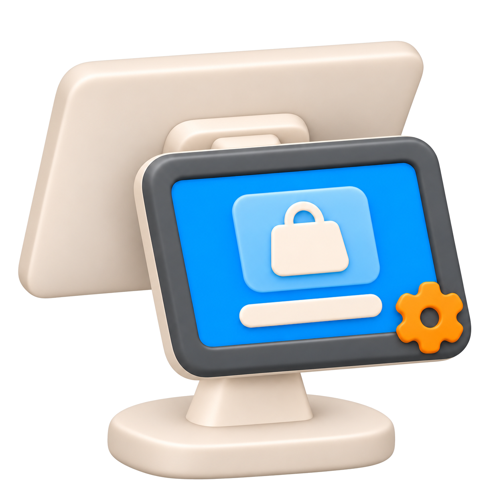
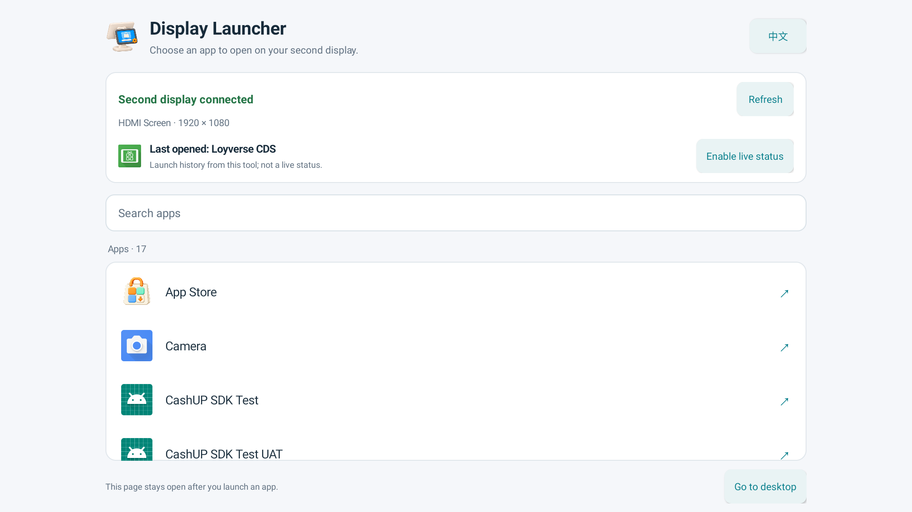

<div align="center">



# Display Launcher

**Choose an app on the main screen. Open it on a second display.**

A small Android tool for customer displays and other dual-screen setups.<br>
The app picker stays on the main screen, with a button to return to your desktop.

**English** · [简体中文](README.zh-CN.md)

<a href="https://github.com/a114126541/Display-launcher/releases/latest"></a>
<a href="#installation"></a>

<a href="https://github.com/a114126541/Display-launcher/releases/latest"></a>




</div>

## Features

- Search installed apps with a launcher entry and open the selected app on a second display.
- Automatically select the only available public secondary display, or show a picker when several are available.
- Keep Display Launcher open on the main screen after launching an app. Use **Go to desktop** when you want to leave.
- Show the **Last opened** app by default, clearly marked as launch history. Optional Accessibility access enables **Now showing** status on Android 11 or later.
- Switch between English and Simplified Chinese. The language choice is remembered.

The APK is about 245 KB. Basic launching needs no root, network permission, or Accessibility access. Live status uses a separate, optional system-managed service.

## Installation

Download `Display-Launcher-1.0.0.apk` from [Releases](https://github.com/a114126541/Display-launcher/releases/latest), transfer it to the Android device, and open it to install. Android may ask you to allow installation from the file manager or browser you use.

If ADB is already connected:

```sh
adb devices
adb -s <device-serial> install -r Display-Launcher-1.0.0.apk
```

Replace `<device-serial>` with the device listed by `adb devices`. The app itself does not need ADB or a computer after installation.

## Use

1. Open **Display Launcher** on the main screen.
2. Check that a second display is connected. Select the target if there is more than one.
3. Search for an app, such as **Loyverse CDS**, and tap it.
4. The selected app opens on the second display while the picker stays on the main screen.
5. Tap **Go to desktop** to leave the picker, then open your POS or another app manually.

The picker works from the main screen. Setup and interaction inside the launched app may still require input on that display. Display Launcher does not pair CDS with a POS or control the launched app's interface.

## Display status

| Access | What the status means |
|---|---|
| Not enabled | **Last opened** records the last app launched through this tool. It does not confirm that the app is still on screen. |
| Enabled, Android 11+ | **Now showing** identifies the owner of the top application window on the selected secondary display. |
| Enabled, but the window cannot be read | The tool shows an unavailable or connecting state instead of presenting launch history as current. |

To enable live status, tap **Enable live status**, read the explanation, and open Android Accessibility settings. Select **Display Launcher status**, enable it, and confirm Android's permission dialog. Return to the app afterward.

You can disable the service in the same system settings. The tool then returns to **Last opened** mode. Android grants broad window access for this capability; the implementation uses window ownership only, without reading page text or performing gestures. See [Privacy](docs/PRIVACY.md).

## Compatibility

The APK requires Android 8.0 or later. The firmware must support independent activities on public secondary displays. Live status requires Android 11 or later and user authorization.

| Device tested | Android | Displays | Apps checked |
|---|---|---|---|
| FH156A17-D / RK3566 | 11 | Two, each 1920 × 1080 | Loyverse CDS 1.8 and Android Settings |

Cold and warm launches, moving CDS from the main display, language switching, the desktop button, and granting/revoking live-status access were verified. Live status also followed an app change made outside this tool. See the [validation record](qa/VALIDATION.md).

Full device reboot, physical display disconnection, several simultaneous secondary displays, and other device models have not been tested. Some apps or firmware may reject secondary-display launches or move an app back to the main screen. A display that only supports hardware mirroring cannot be made independent by this tool.

## Questions

**Does it replace the system launcher?** No. It is a normal app; **Go to desktop** returns to the existing desktop.

**Does it start automatically at boot?** No. Open it manually from the main screen.

**Why is an app missing?** The list contains apps with a desktop launcher entry. Background-only packages are not listed.

**Does it include POS or CDS?** No. Install and configure those apps separately.

## Build and test

The app uses native Android views and Java, with no third-party runtime libraries. Building requires Python 3, JDK 17+, Android SDK Platform 35, and Build Tools 35.0.0. The build script has been verified on macOS.

```sh
git clone https://github.com/a114126541/Display-launcher.git
cd Display-launcher
python3 build.py --java-home /path/to/jdk --sdk /path/to/Android/sdk
```

The APK is written to `dist/`. A new checkout creates its own local signing key, so a locally built APK cannot update the published APK unless it uses the same signing identity. Keys, credentials, build output, and raw device logs are excluded from the repository.

Build details, test commands, and artwork sources are in [Development](docs/DEVELOPMENT.md).

## Feedback and license

Report problems in [Issues](https://github.com/a114126541/Display-launcher/issues), including the device model, Android version, target app, and whether the display is independent or mirrored. Remove personal information from screenshots and logs before sharing.

A license has not been specified in this repository.
