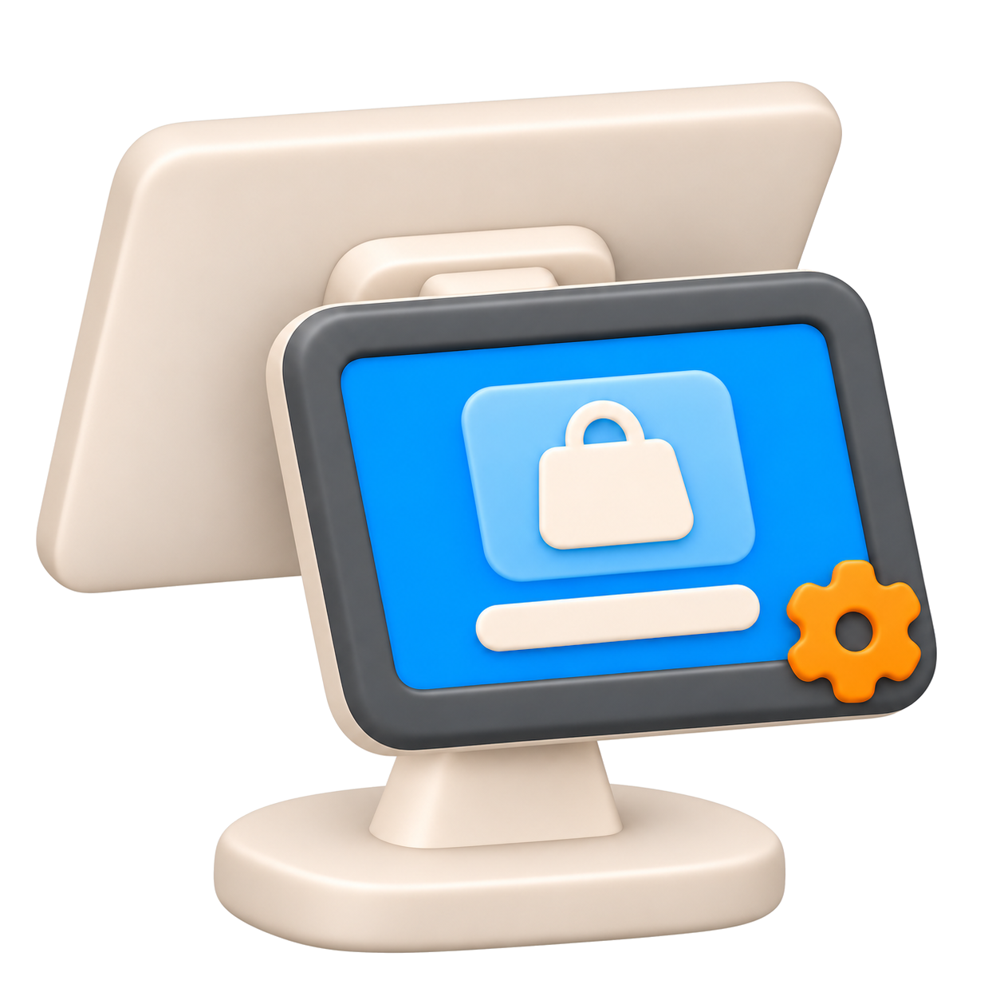
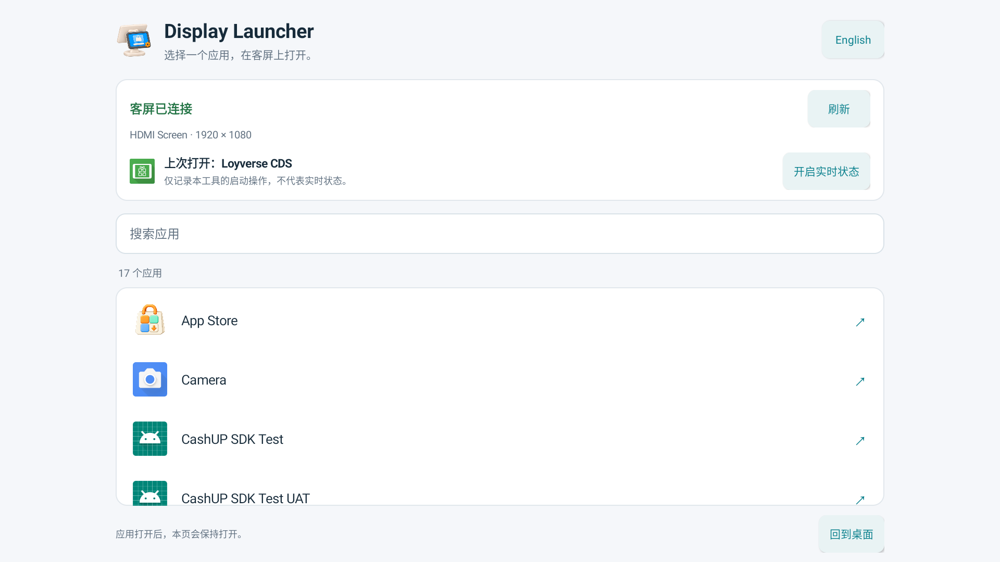

<div align="center">



# Display Launcher

**在主屏选择应用，把它打开到客屏。**

一个用于客显和其他双屏场景的轻量安卓工具。<br>
应用列表留在主屏，需要离开时再点击“回到桌面”。

[English](README.md) · **简体中文**

<a href="https://github.com/a114126541/Display-launcher/releases/latest"></a>
<a href="#安装"></a>

<a href="https://github.com/a114126541/Display-launcher/releases/latest"></a>




</div>

## 功能

- 搜索有桌面启动入口的已安装应用，并将所选应用打开到客屏。
- 只有一块可用的公共副屏时自动选择；有多块时显示屏幕选择器。
- 应用打开后，Display Launcher 继续留在主屏。点击“回到桌面”时才离开。
- 默认显示“上次打开”的应用，并明确标记为启动记录。Android 11 及以上可通过可选的无障碍授权，显示“当前显示”的应用。
- 中英文可切换，并记住语言选择。

APK 约 245 KB。基本启动功能不需要 root、网络权限或无障碍授权。实时状态使用单独的可选服务，由系统管理。

## 安装

从 [Releases](https://github.com/a114126541/Display-launcher/releases/latest) 下载 `Display-Launcher-1.0.0.apk`，传到安卓设备后打开安装。Android 可能会要求允许当前文件管理器或浏览器安装应用。

如果已经连接 ADB：

```sh
adb devices
adb -s <device-serial> install -r Display-Launcher-1.0.0.apk
```

将 `<device-serial>` 替换为 `adb devices` 列出的设备标识。安装后，应用本身不依赖 ADB 或电脑。

## 使用

1. 在主屏打开 **Display Launcher**。
2. 确认客屏已连接；如果有多块副屏，选择目标屏幕。
3. 搜索并点击需要打开的应用，比如 **Loyverse CDS**。
4. 所选应用在客屏打开，应用列表继续留在主屏。
5. 点击“回到桌面”离开列表，再手动打开 POS 或其他应用。

选择和启动可以在主屏完成。被启动应用内部的设置和交互，仍可能需要在它所在的屏幕上输入。Display Launcher 不负责 CDS 与 POS 配对，也不控制被启动应用的界面。

## 客屏状态

| 授权状态 | 显示含义 |
|---|---|
| 未开启 | **上次打开**记录本工具最后一次启动的应用，不代表它仍在客屏显示。 |
| 已开启，Android 11 及以上 | **当前显示**识别所选副屏最上层应用窗口所属的应用。 |
| 已开启，但窗口无法读取 | 显示暂不可用或连接中，不会把启动记录当作当前状态。 |

需要实时状态时，点击“开启实时状态”，阅读说明后前往系统无障碍设置。找到 **Display Launcher status / Display Launcher 状态识别**，开启服务并确认 Android 的授权提示，再返回应用。

可随时在同一系统设置中关闭服务，工具会恢复为“上次打开”模式。Android 为这个能力授予的窗口访问权限较广；当前实现只使用窗口所属应用，不读取页面文字、不执行手势。详见[隐私说明](docs/PRIVACY.md#简体中文)。

## 兼容性

APK 最低要求 Android 8.0，设备固件需要支持在公共副屏上独立运行应用。实时状态最低要求 Android 11，并需要用户授权。

| 实测设备 | Android | 屏幕 | 检查过的应用 |
|---|---|---|---|
| FH156A17-D / RK3566 | 11 | 两块，均为 1920 × 1080 | Loyverse CDS 1.8、系统 Settings |

已验证冷启动、已运行应用的再次打开、将 CDS 从主屏移到副屏、中英文切换、回到桌面按钮，以及实时状态授权和撤销。实时状态也能跟随本工具之外发起的应用切换。详见[验证记录](qa/VALIDATION.md)。

尚未测试整机重启、物理断开副屏、同时连接多块副屏及其他设备型号。部分应用或固件可能拒绝副屏启动，或将应用重新移回主屏。只支持硬件镜像的屏幕，无法通过本工具变成独立副屏。

## 常见问题

**会替换系统桌面吗？** 不会，它是一个普通应用。“回到桌面”会返回原有桌面。

**会开机自动启动吗？** 不会，需要在主屏手动打开。

**为什么找不到某个应用？** 列表只显示有桌面启动入口的应用，不列出仅在后台运行的软件包。

**包含 POS 或 CDS 吗？** 不包含，需要单独安装和配置。

## 构建与测试

应用使用原生 Android 界面和 Java，没有第三方运行时库。构建需要 Python 3、JDK 17 及以上、Android SDK Platform 35，以及 Build Tools 35.0.0。构建脚本已在 macOS 上验证。

```sh
git clone https://github.com/a114126541/Display-launcher.git
cd Display-launcher
python3 build.py --java-home /path/to/jdk --sdk /path/to/Android/sdk
```

APK 输出到 `dist/`。新克隆的项目会创建自己的本地签名密钥，只有使用相同签名身份，本地构建的 APK 才能覆盖更新发布版。密钥、密码、构建产物和原始设备日志均不包含在仓库中。

构建细节、测试命令和图标资源说明见[开发说明](docs/DEVELOPMENT.md#简体中文)。

## 反馈与许可

遇到问题可通过 [Issues](https://github.com/a114126541/Display-launcher/issues) 反馈，附上设备型号、Android 版本、目标应用，以及副屏是独立输出还是镜像。公开截图和日志前，请移除个人信息。

当前仓库尚未指定许可证。
